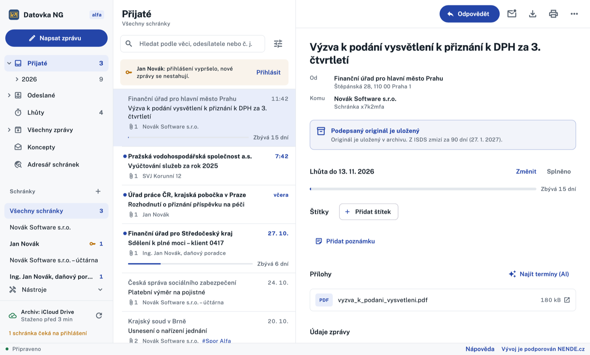

<p align="center">
  <picture>
    <source media="(prefers-color-scheme: dark)" srcset="branding/logo/logo-zlute-pruhledne.svg">
    
  </picture>
</p>

<h1 align="center">Datovka NG</h1>

<p align="center">
  Klient datových schránek (ISDS) pro Mac, iPhone, Android, Linux a Windows.<br>
  Pracuje se stejným archivem jako původní Datovka, jen je rychlejší a přehlednější.
</p>

<p align="center"></p>

> **Stav: alfa.** Každodenní práce se zprávami funguje. Některé funkce zatím
> nejsou ověřené proti ostrému ISDS, přehled je v [FEATURES.md](FEATURES.md).

## Pro koho

Pro každého, kdo má datovou schránku, a hlavně pro ty, kdo jich mají hodně:
advokáty, účetní, daňové poradce, správce firem. Desítky schránek jsou
v jednom okně, stahují se samy a zprávy se dají procházet po letech
a měsících.

## Co umí

- **Všechny schránky najednou.** Přijaté, odeslané, lhůty a koncepty pro
  jednu schránku nebo pro všechny. Počty se řídí vybranou schránkou.
- **Archiv původní Datovky bez převodu.** Čte a zapisuje její soubory
  (`dsgui.conf`, databáze zpráv, štítky, časová razítka), takže se dá kdykoli
  vrátit k původní aplikaci a ta pokračuje nad stejnými daty.
- **Jeden archiv na Macu, iPhonu i dalších počítačích.** Archiv může ležet na
  iCloud Drive nebo ve sdílené složce. Číst jde odkudkoli najednou, zápis si
  bere krátký zámek, aby se soubory nerozbily.
- **Všechny způsoby přihlášení:** jméno a heslo, SMS kód, kód z aplikace,
  mobilní klíč, certifikát. Schránky se SMS nebo mobilním klíčem se na pozadí
  nepřihlašují a nikoho neruší, jen počkají na přihlášení.
- **Lhůty.** U zprávy si nastavíte termín, aplikace ho hlídá a ukáže, kolik
  zbývá. Do kalendáře jde lhůta o den dřív, aby se stihla.
- **Psaní zpráv** s přetažením příloh, více adresátů, poštovní datové zprávy,
  velkoobjemové zprávy nad 20 MB, koncepty sdílené mezi zařízeními.
- **Ověření podpisu a časového razítka** přímo v počítači, přerazítkování
  originálu v ISDS, seznam smazaných zpráv.
- **Štítky, poznámky, hledání** bez ohledu na diakritiku, adresář schránek
  a kontakty z korespondence.
- **Elektronická podání** (výpisy z rejstříků a registrů) a ukládání do
  spisové služby.
- **AI asistent na vyžádání.** Přečte přílohy, najde lhůty a termíny
  a připraví je do kalendáře. Spouští se jen tlačítkem, nikdy sám, a předem
  ukáže, co se pošle ven. Připojit jde vlastní API klíč (Claude, OpenAI),
  model v počítači, nebo nic.
- **Na iPhonu** zámek přes Face ID nebo kód telefonu a přílohy v náhledu.

## Soukromí a bezpečnost

- Hesla ke schránkám jsou v systémovém úložišti hesel (Klíčenka na Macu
  a iPhonu, Správce pověření ve Windows, Secret Service na Linuxu). Do
  sdíleného archivu ani na iCloud se nedostanou.
- Aplikace nic neměří a neposílá data o používání. Spojuje se jen s ISDS,
  s GitHubem kvůli aktualizacím a se službami, které sami zapnete (AI
  asistent, spisová služba).

## Ke stažení

Balíčky jsou u [vydání](https://github.com/intiocz/datovka-ng/releases):

| Systém | Soubor | Jak nainstalovat |
|---|---|---|
| macOS 12 a novější | `DatovkaNG-macos.zip` | rozbalit, přetáhnout do Aplikací, poprvé otevřít pravým tlačítkem → Otevřít |
| Ubuntu, Debian, Mint | `DatovkaNG-linux-amd64.deb` | `sudo apt install ./DatovkaNG-linux-amd64.deb` |
| Windows 10 a 11 | `DatovkaNG-windows-amd64.zip` | rozbalit a spustit `datovka-ng.exe` (zatím málo vyzkoušené) |
| Android 7 a novější | `DatovkaNG-android.apk` | otevřít v telefonu a povolit instalaci (zkušebně) |
| iPhone | – | v App Store není, sestavuje se v Xcode, viz [vývoj](docs/vyvoj.md) |

Aplikace se při startu podívá, jestli není novější vydání. Na Macu, Linuxu
a Windows se umí aktualizovat sama.

Program se jmenuje `datovka-ng`, takže původní Datovka zůstane nainstalovaná
vedle.

## Dokumentace

- [Uživatelská příručka](docs/prirucka.md)
- [Co umí oproti původní Datovce](FEATURES.md)
- [Architektura a formát dat](docs/architektura.md)
- [Vývoj, testy, sestavení](docs/vyvoj.md)

Nápověda je i v aplikaci, odkaz je dole ve stavovém řádku.

## Vývoj

Jádro je v Rustu (`core/`: ISDS, archiv, podpisy), aplikace ve Flutteru
(`app/`). Spojuje je C rozhraní v `ffi/`.

```sh
cargo test                      # jádro
cd app && flutter test          # aplikace
scripts/build-macos.sh          # Mac: sestaví datovka-ng.app a DMG
```

Podrobnosti pro Linux, Windows a iPhone jsou v [docs/vyvoj.md](docs/vyvoj.md).

## Licence

[PolyForm Noncommercial 1.0.0](LICENSE). Program smíte používat, upravovat
a šířit, **nesmíte ho prodávat**.

Vývoj je podporován
[NENDE.cz](https://nende.cz/?utm_source=github&utm_medium=readme&utm_campaign=datovka-ng),
monitoringem veřejných zakázek.

Datovka NG není produktem CZ.NIC ani Ministerstva vnitra. Původní Datovku
vyvíjí CZ.NIC.
